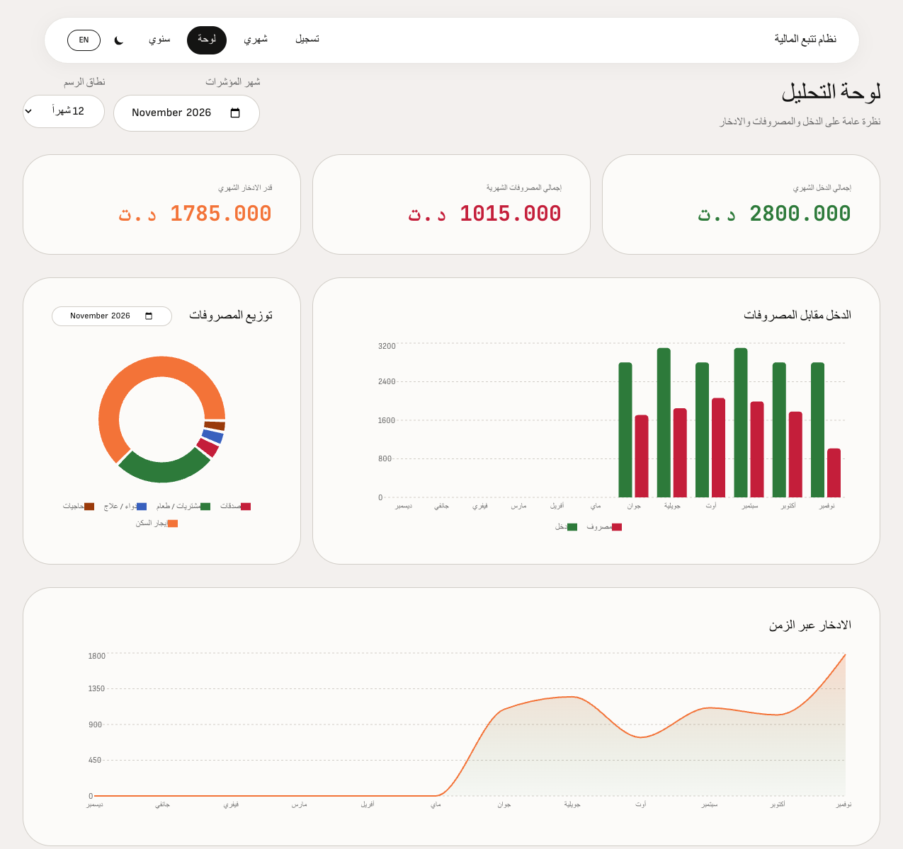
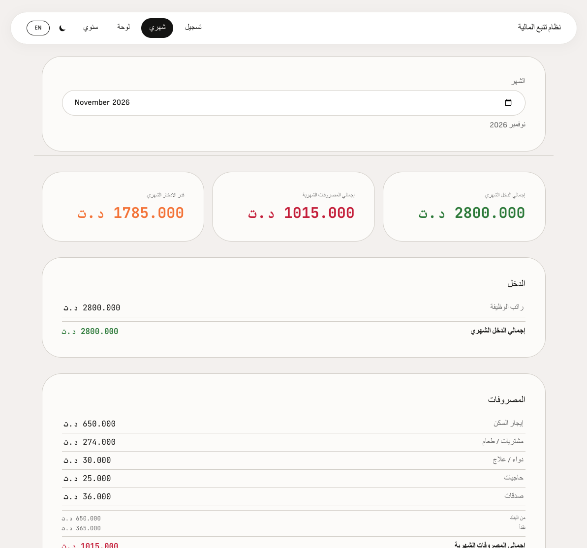
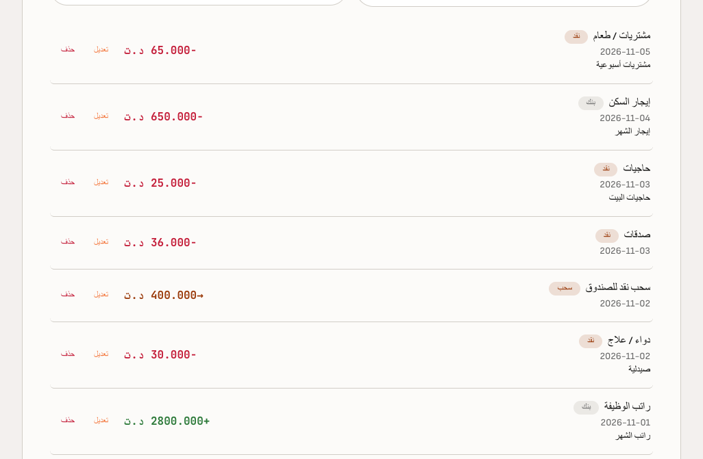
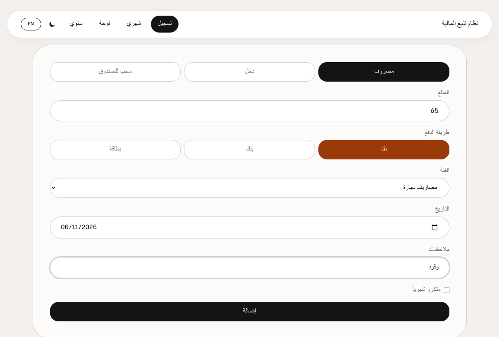

# Mizan (ميزان)
### Personal Finance Tracker

**English** | **[العربية](README.md)**

**Mizan** (ميزان — *balance*) is a bilingual (Arabic / English) personal finance web app with transaction logging, monthly budgets, analytics dashboards, and a spreadsheet-style year view. Data is stored in **PostgreSQL** via a **FastAPI** backend.

Inspired by a personal Tunisian household expense sheet.

## Screenshots

### Dashboard



### Monthly statistics



### Transaction logs



### Log entry



## Quick add

On the Log page, type one spend per line, or paste a whole note from your phone:

```
3/11
essence 60
pain et lait 4,2
netflix 12.99€
hier
صيدلية 18
```

Press **Enter** (or **Read**). Each line becomes a draft you can fix, then **Save** them all.
A date-only line applies to the lines below. `€` means card/EUR. The app learns
"word → category" each time you save; see **Learned words** to delete wrong ones.

## Stack

| Layer | Technology |
|---|---|
| Frontend | React 19, Vite, Tailwind CSS, Recharts |
| Backend | Python 3.12, FastAPI, SQLAlchemy |
| Database | PostgreSQL 16 |
| DevOps | Docker Compose |

## Quick start (Docker)

**Requirements:** [Docker](https://docs.docker.com/get-docker/) and [Docker Compose](https://docs.docker.com/compose/)

```bash
# 1. Copy environment template
cp .env.example .env

# 2. Start database + API
npm run docker:up

# 3. Install frontend deps and run dev server
npm install
npm run dev
```

Open [http://localhost:5173](http://localhost:5173). The Vite dev server proxies `/api` to the API on port 8000.

### Docker commands

| Command | Description |
|---|---|
| `npm run docker:up` | Start PostgreSQL + API (detached) |
| `npm run docker:down` | Stop and remove containers |
| `npm run docker:logs` | Follow API logs |
| `npm run docker:full` | Build and run DB + API + production web (port 8080) |

**`docker:up` vs `docker:full`:** `npm run docker:up` (same as `docker compose up -d`) starts only **PostgreSQL + the API**. Run the UI separately with `npm run dev` on port 5173. Use `npm run docker:full` when you want everything in Docker—including a production build of the frontend served by nginx on port **8080** (rebuilds images with `--build`).

API docs (Swagger): [http://localhost:8000/docs](http://localhost:8000/docs)

## Local backend development (Python)

**Python:** 3.12 (see `.python-version` and `backend/requirements.txt`)

```bash
# Create virtualenv (recommended)
cd backend
python3.12 -m venv .venv
source .venv/bin/activate   # Windows: .venv\Scripts\activate
pip install -r requirements.txt
cp .env.example .env

# Start Postgres only
docker compose up -d db

# Run API with hot reload
uvicorn app.main:app --reload --port 8000
```

Or with conda (if you use it elsewhere in your machine):

```bash
conda create -n finance-system python=3.12 -y
conda activate finance-system
pip install -r backend/requirements.txt
```

> **Port 5432 conflict:** if you also run a local Postgres (e.g. Homebrew), it
> answers on `localhost:5432` before Docker does. Stop it, or set
> `POSTGRES_PORT=5433` in `.env` and use that port in `DATABASE_URL`.

### Database migrations (Alembic)

The schema is managed by [Alembic](https://alembic.sqlalchemy.org/). The API runs
`alembic upgrade head` on every start (`backend/app/migrate.py`), so a normal
`docker compose up` is enough. An old database without migration history is
detected and upgraded automatically.

To change the schema:

```bash
cd backend
# 1. Edit app/models.py
# 2. Generate a migration, then READ and fix it before committing
.venv/bin/alembic revision --autogenerate -m "short description"
# 3. Apply it (or just restart the API)
.venv/bin/alembic upgrade head
```

Money columns use `NUMERIC(12, 3)` (never float). Take a backup before a big migration:
`docker exec finance-backup /backup.sh`.

### Tests

```bash
cd backend
pip install -r requirements-dev.txt
pytest
```

Tests start a throwaway Postgres in Docker (testcontainers), so Docker must be
running. They never touch your real database. Frontend checks:
`npm run lint` and `node --test src/lib/*.test.mjs`.

## Project structure

```
finance-system/
├── backend/           # FastAPI + SQLAlchemy
│   ├── app/           # API code (categories.py = category list)
│   ├── alembic/       # database migrations
│   └── tests/         # pytest suite
├── scripts/           # seed_demo.py (fake data for demos)
├── src/               # React frontend
├── docker-compose.yml
├── Dockerfile.web     # Production frontend (nginx)
└── spec.md            # Product specification
```

## Backups

The `backup` service (started with `npm run docker:up`) runs `pg_dump` every day at midnight
(Africa/Tunis) and writes gzip files to `./backups/` on your machine.
It keeps 7 daily, 4 weekly and 6 monthly copies. `backups/` is git-ignored.

```
backups/
├── last/     # every run, newest is finance-latest.sql.gz
├── daily/
├── weekly/
└── monthly/
```

**Take a backup now**

```bash
docker exec finance-backup /backup.sh
```

**Restore a backup** (replaces the current data in the `finance` database)

```bash
gunzip -c backups/last/finance-latest.sql.gz | docker exec -i finance-db psql -U finance -d finance -v ON_ERROR_STOP=1
```

Use another file from `daily/`, `weekly/` or `monthly/` to go back further.
If you changed `POSTGRES_USER` or `POSTGRES_DB` in `.env`, use those values instead of `finance`.

> Tip: copy `backups/` to a cloud folder or an external disk from time to time.
> A backup on the same disk does not help if the disk dies.

## Environment variables

See [`.env.example`](.env.example) for all options.

| Variable | Default | Purpose |
|---|---|---|
| `POSTGRES_USER` | `finance` | DB user |
| `POSTGRES_PASSWORD` | `finance` | DB password |
| `API_PORT` | `8000` | Host port for API |
| `VITE_API_URL` | `/api` (dev proxy) | Frontend API base URL |

## License

MIT — see [LICENSE](LICENSE).
