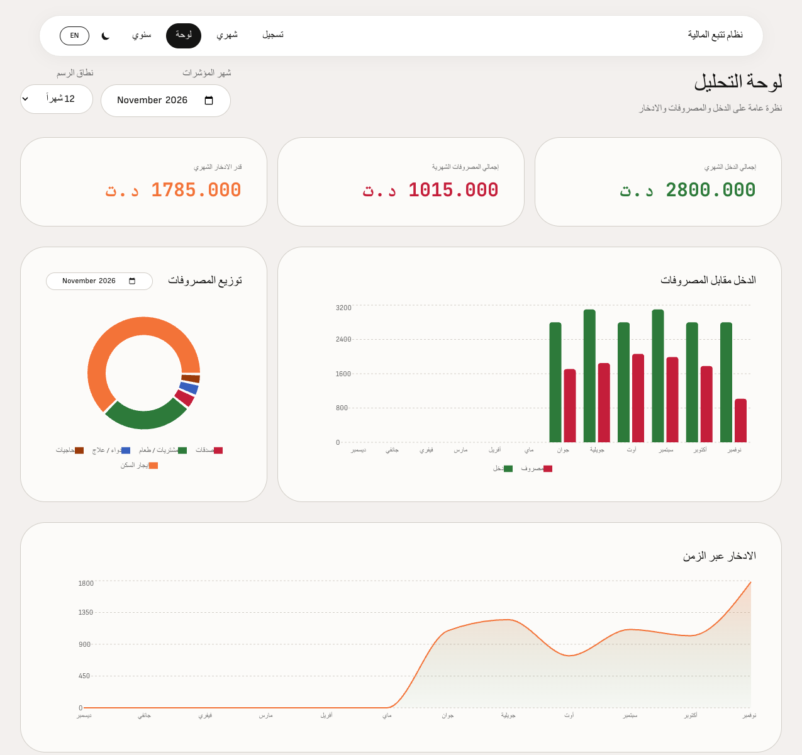
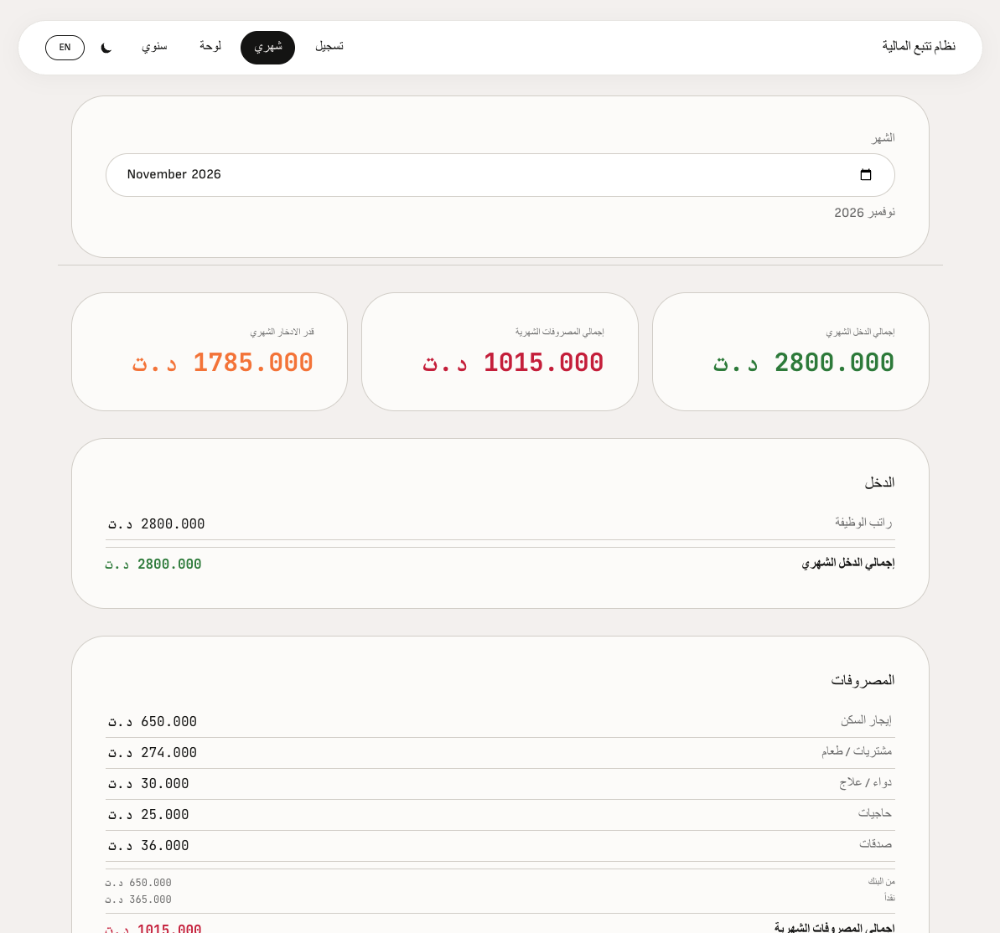
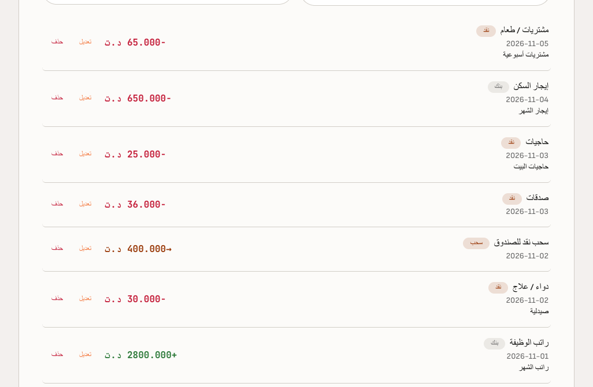
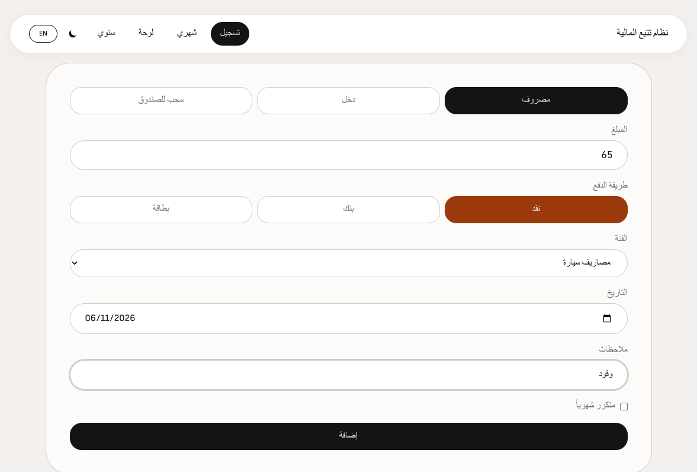

# ميزان (Mizan)
### نظام تتبع المالية الشخصية

**[English](README.en.md)** | العربية

**ميزان** — تطبيق ويب ثنائي اللغة (عربي / إنجليزي) لتتبع المالية الشخصية: تسجيل المعاملات، الميزانيات الشهرية، لوحات تحليلية، وعرض سنوي على شكل جدول. تُخزَّن البيانات في **PostgreSQL** عبر واجهة **FastAPI**.

مستوحى من جدول مصروفات منزلي تونسي شخصي.

## لقطات الشاشة

### لوحة التحكم



### الإحصائيات الشهرية



### سجل المعاملات



### إدخال معاملة



## التقنيات

| الطبقة | التقنية |
|---|---|
| الواجهة | React 19، Vite، Tailwind CSS، Recharts |
| الخادم | Python 3.12، FastAPI، SQLAlchemy |
| قاعدة البيانات | PostgreSQL 16 |
| النشر | Docker Compose |

## البدء السريع (Docker)

**المتطلبات:** [Docker](https://docs.docker.com/get-docker/) و [Docker Compose](https://docs.docker.com/compose/)

```bash
# 1. نسخ ملف البيئة
cp .env.example .env

# 2. تشغيل قاعدة البيانات + API
npm run docker:up

# 3. تثبيت الواجهة وتشغيل خادم التطوير
npm install
npm run dev
```

افتح [http://localhost:5173](http://localhost:5173). خادم Vite يوجّه `/api` إلى الـ API على المنفذ 8000.

### أوامر Docker

| الأمر | الوصف |
|---|---|
| `npm run docker:up` | تشغيل PostgreSQL + API (في الخلفية) |
| `npm run docker:down` | إيقاف الحاويات وحذفها |
| `npm run docker:logs` | متابعة سجلات الـ API |
| `npm run docker:full` | بناء وتشغيل DB + API + الواجهة للإنتاج (منفذ 8080) |

**الفرق بين `docker:up` و `docker:full`:** `npm run docker:up` (مثل `docker compose up -d`) يشغّل **PostgreSQL + API فقط**. شغّل الواجهة بـ `npm run dev` على المنفذ 5173. استخدم `npm run docker:full` لتشغيل كل شيء داخل Docker—بما في ذلك نسخة إنتاج من الواجهة عبر nginx على المنفذ **8080** (يعيد بناء الصور بـ `--build`).

وثائق الـ API (Swagger): [http://localhost:8000/docs](http://localhost:8000/docs)

## تطوير الخادم محلياً (Python)

**Python:** 3.12 (انظر `.python-version` و `backend/requirements.txt`)

```bash
# إنشاء بيئة افتراضية (موصى به)
cd backend
python3.12 -m venv .venv
source .venv/bin/activate   # Windows: .venv\Scripts\activate
pip install -r requirements.txt
cp .env.example .env

# تشغيل Postgres فقط
docker compose up -d db

# تشغيل API مع إعادة التحميل التلقائي
uvicorn app.main:app --reload --port 8000
```

أو باستخدام conda:

```bash
conda create -n finance-system python=3.12 -y
conda activate finance-system
pip install -r backend/requirements.txt
```

## هيكل المشروع

```
finance-system/
├── backend/           # FastAPI + SQLAlchemy
├── src/               # واجهة React
├── docker-compose.yml
├── Dockerfile.web     # واجهة الإنتاج (nginx)
└── spec.md            # مواصفات المنتج
```

## متغيرات البيئة

انظر [`.env.example`](.env.example) لكل الخيارات.

| المتغير | الافتراضي | الغرض |
|---|---|---|
| `POSTGRES_USER` | `finance` | مستخدم قاعدة البيانات |
| `POSTGRES_PASSWORD` | `finance` | كلمة مرور قاعدة البيانات |
| `API_PORT` | `8000` | منفذ الـ API على الجهاز |
| `VITE_API_URL` | `/api` (بروكسي التطوير) | عنوان واجهة الـ API للواجهة الأمامية |

## الترخيص

MIT — انظر [LICENSE](LICENSE).
